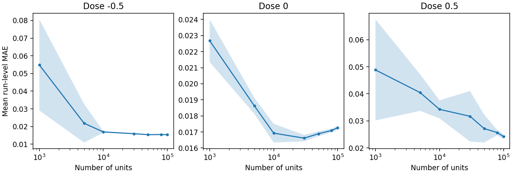

# Distribution-valued Causal Machine Learning

Simulation code for *Causal Policy Evaluation with Distribution-valued Outcomes under Continuous Interventions*.

## Reproduce the simulations

```bash
python -m pip install -r requirements.txt
python replicate.py
```

Use Python 3.8 to 3.11. The default command rebuilds Table 1 and Figures 3–5 from `reference/` and writes them to `outputs/archive/`.

| Task | Command |
| --- | --- |
| Train a small example on CPU | `python replicate.py --mode train --preset smoke --device cpu` |
| Generate simulation data | `python replicate.py --mode generate` |
| Retrain the paper simulations | `python replicate.py --mode train` |

Each unit has covariates `X`, assigned dose `A`, and repeated outcomes `Y`. The estimator sorts the outcomes to form a nine-point quantile curve. Defaults use two folds, the Epanechnikov kernel and paper bandwidth rule, NFR widths `[64, 64]`, CNF width `32`, and seed `1`.

Training saves fold checkpoints, convergence logs, and overlap, weight, and bandwidth diagnostics. Use `--observations 50` to check sensitivity to fewer measurements per unit and `--help` for other settings.

## Figure 4



The lines show mean run-level MAE across 100 simulation runs. The shaded areas show one standard deviation.
