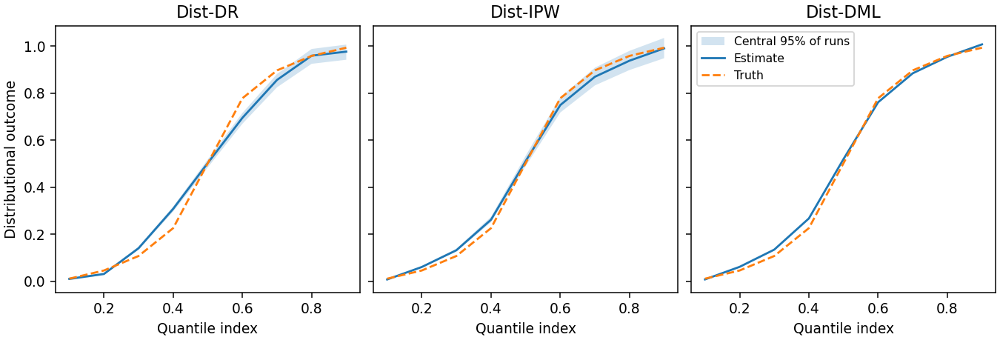

# Distribution-valued Causal Machine Learning

Code and simulated results for Figure 3 of *Causal Policy Evaluation with Distribution-valued Outcomes under Continuous Interventions*.

## Reproduce Figure 3

```bash
python -m pip install -r requirements.txt
python replicate.py
```

Use Python 3.8 to 3.11. The default command renders the PNG and PDF in `outputs/archive/` from the 100 archived runs at dose zero. The archive stores the true curve and the Dist-DR, Dist-IPW, and Dist-DML estimates on the nine-point quantile grid.

Run `python replicate.py --mode train` to generate the synthetic data and retrain all 100 replications with 50,000 units per replication. The default uses two folds, an Epanechnikov kernel, and seed 1. For a short training check, add `--reps 1 --epochs-dr 1 --epochs-cnf 1`.



Shading shows the 2.5th and 97.5th percentiles across simulation runs.
